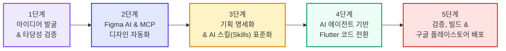

# 🤖 [보건약학프로젝트] AI 협업 헬스케어 앱 개발 프로세스 보고서

> **문서 개요**: 본 문서는 프로그래밍 및 AI에 대한 사전 배경지식이 없는 청중(약학대학 교수님, 학우, 비전공자)도 쉽게 이해할 수 있도록, 기획 아이디어 발굴부터 피그마(Figma) 디자인, AI 기반 아키텍처 설계, 코드 전환 및 스토어 출시에 이르는 **전 과정의 AI 협업 개발 방법론(AI Pair-Programming Pipeline)**을 체계적으로 정리한 발표·보고용 가이드임.

---

## 1. 개요: 약대생 팀이 AI를 협업 파트너로 선택한 이유

모바일 헬스케어 서비스는 **[보건약학적 전문 지식(약효 지속 시간, 치료역, 환자 복약 심리)]**과 **[고난도 소프트웨어 공학(모바일 UI/UX, 클라우드 동기화, 상태 관리, 스토어 배포)]**이 동시에 요구되는 융합 프로젝트임.

약학 전공 학부생 팀으로서 코딩 지식의 한계를 극복하고 완성도 높은 실제 동작 앱을 제작하기 위해, AI를 단순한 질의응답기가 아닌 **기획자, UI 디자이너, 시니어 소프트웨어 엔지니어 역할을 분담하는 '가상 팀원(AI Pair Programmer)'**으로 프로세스 전반에 투입함.

---

## 2. 단계별 AI 협업 상세 프로세스

### [1단계] 아이디어 도출 및 기술적 타당성 검증 (Ideation & Feasibility)
* **진행 방식**:
  - 조원들이 모여 자유 브레인스토밍을 진행함 (ADHD/우울증 환자의 복약 타이트레이션, 뇌과학 기반 게이미피케이션, 마스코트 인터랙션 등).
  - 도출된 아이디어가 실제로 기술적으로 구현 가능한지, 환자 경험에 부작용은 없는지를 AI에게 자문하는 **사운딩 보드(Sounding Board)** 방식으로 대화하며 현실적인 구현 방향을 좁혀나감.
* **AI의 역할**:
  - *"ADHD 환자에게 실패 시 벌칙을 주는 게이미피케이션이 효과적인가?"* ➔ AI 분석 결과: 실패 강박과 자책감을 심화시켜 앱 이탈(Churn)을 부르므로 '비처벌적 누적 보상 UX'가 학술적으로 적합함을 확인.
  - 지나간 과거 날짜의 수정 허용 여부에 대해 '당일 완결형 루틴 원칙'과 'XP 소모형 연속 보호권' 아이디어를 정립함.

---

### [2단계] UI/UX 화면 설계 및 Figma AI 자동화 (Design Automation)
* **Figma 내장 AI 활용**:
  - 초기 기획안을 바탕으로 Figma AI 프롬프트를 통해 주요 화면(복약, 습관, 달력, 마스코트)의 초기 와이어프레임 골격을 신속히 생성함.
* **사람과 AI의 협업 방식**:
  - **직접 지시**: 명확한 방향이 정해진 요소는 구체적인 규격(36×36 dp 원형 아바타, 2×1 위젯)을 AI에게 직접 지시함.
  - **시안 추천(A/B 테스트)**: 레이아웃이 고민될 때는 AI에게 5~6가지 대안 시안(1안: 도파민 연속 달성, 2안: 마스코트 응원 등)을 한 번에 뽑아내게 한 뒤 조원 토론을 거쳐 최적의 안을 선별함.
* **한계 극복: Figma MCP(Model Context Protocol) 도입**:
  - Figma 자체 AI의 월 사용 한도가 소진되는 문제가 발생함.
  - 해결책으로 **Figma MCP**를 구축하여 외부 AI(Antigravity)와 Figma 캔버스를 직접 연결함.
  > 💡 **비전공자를 위한 개념 설명: MCP(Model Context Protocol)란?**  
  > AI는 본래 텍스트 창 안에 갇혀 있는 존재임. MCP는 AI에게 피그마 프로그램의 내부를 들여다보고 직접 버튼을 누르고 화면을 그릴 수 있는 **'원격 조종 리모컨(전용 통신 파이프라인)'**을 쥐어주는 최신 표준 기술임.
  - AI가 Figma 스크립터(Scripter) 및 플러그인 전용 자바스크립트 코드([`figma_scripter_companion.js`](file:///c:/Users/nahap/Desktop/2026/2-2/project_hagom/figma_scripter_companion.js))를 직접 작성하여, 수백 개의 텍스트·색상·화면 전환 연결선(Flow Prototype)을 원클릭으로 캔버스에 일괄 자동 적용함.

---

### [3단계] 기획 명세화 및 AI 스킬(Skills) 표준화 (Current Stage)
* **기획 명세서(PRD) 수립**:
  - 피그마 시안과 조원 논의 내역을 종합하여 [엔지니어링 기획명세서(`PRD_기획명세서.md`)](file:///c:/Users/nahap/Desktop/2026/2-2/project_hagom/PRD_기획명세서.md)와 [보건약학적 배경 보고서](file:///c:/Users/nahap/Desktop/2026/2-2/project_hagom/보고서_기획서_보건약학적_배경.md)로 이원화 체계화함.
* **AI 스킬(Agent Skills) 체계 구축**:
  - 단순 문서에 머무르지 않고, AI 에이전트가 코드를 짤 때 언제든 꺼내볼 수 있는 **지침서 패키지(`.agents/skills`)**를 프로젝트 내에 구성함.
  > 💡 **비전공자를 위한 개념 설명: AI 스킬(Skills)이란?**  
  > AI에게 무작정 "앱 만들어줘"라고 하면 제각각으로 코드를 작성해 엉망이 됨. 스킬은 AI에게 **'Flutter 공식 코딩 표준', 'Riverpod 상태 관리 교본', '피그마 디자인 변환 가이드'** 같은 전문 매뉴얼을 주입해, 경험 많은 수석 개발자처럼 일관되게 행동하도록 통제하는 맞춤형 지침 파일임.
* **외부 검증 스킬 도입**:
  - GitHub 글로벌 오픈소스에서 검증된 스킬셋(`figma-to-flutter`, `flutter-app-architecture`, `flutter-best-practices`, `flutter-riverpod`, `flutter-testing`)을 선별 다운로드하여 에이전트 환경에 장착함.

---

### [4단계] AI 에이전트 기반 프로덕션 코드 전환 (Upcoming Stage)
* **목표**: Figma 디자인과 PRD 명세를 실제 스마트폰에서 터치되고 데이터가 저장되는 **Flutter 모바일 앱 코드**로 100% 전환함.
* **진행 방식**:
  1. `figma-to-flutter` 스킬을 가동하여 Figma 노드의 색상·마진·패딩을 오차 없는 Flutter 위젯 트리로 1:1 변환함.
  2. `flutter-app-architecture` 스킬을 통해 화면(UI), 비즈니스 로직, 로컬 데이터베이스(`SQLite`/`Hive`)를 엄격히 분리하는 클린 아키텍처(MVVM)를 구축함.
  3. 조원 김나연, 김영채가 AI와 실시간 페어 프로그래밍을 진행하며 누락된 엣지 케이스를 보완하고 테스트 코드를 실행함.

---

### [5단계] 빌드, 검증 및 구글 플레이스토어 배포 (Final Stage)
* **목표**: 단순한 과제 제출용 프로토타입에 그치지 않고, 누구나 다운로드할 수 있는 **상용 구글 플레이스토어 정식 출시**.
* **진행 절차**:
  1. 학교 지원금(3만 원) 연계를 바탕으로 Google Play Console 개발자 계정 등록 (\$25).
  2. Flutter 프로덕션 릴리스 빌드(AAB 파일 생성).
  3. AI를 통한 앱 권한 검토, 개인정보 처리방침 문서 자동 생성, 스토어 등록 정보(설명문, 스크린샷 컷) 완비 후 스토어 심사 제출.

---

## 3. 개발에 투입된 AI & 프로그래밍 도구 생태계

| 도구명 | 기술적 역할 | 비전공자를 위한 쉬운 비유 |
| :--- | :--- | :--- |
| **`Figma` & `Figma AI`** | UI/UX 인터페이스 디자인 툴 및 초기 레이아웃 자동 생성 | 건물의 외관과 인테리어를 그리는 **건축 3D 설계도** |
| **`Figma MCP`** | AI 에이전트가 피그마 캔버스를 직접 프로그래밍 제어하는 통신 브릿지 | AI의 손과 발이 되어 피그마를 조작하는 **원격 로봇 팔** |
| **`Antigravity IDE / CLI`** | Google DeepMind 기반의 자율 에이전틱 코딩 개발 환경 | 프로젝트 전체를 파악하고 지시를 수행하는 **AI 수석 개발자** |
| **`Codex CLI / GJC`** | 코드 생성, 스크립트 실행 및 터미널 명령어 자동화 엔진 | 복잡한 코드를 빠르게 번역하고 조립하는 **고성능 엔진** |
| **`GitHub` & `Copilot`** | 코드 버전 관리(VCS), 형상 관리 및 실시간 타이핑 자동완성 | 작업 내역을 잃어버리지 않게 기록하는 **클라우드 타임머신** |
| **`Flutter`** | 하나의 코드로 Android와 iOS 모두에서 작동하는 크로스플랫폼 앱 프레임워크 | 안드로이드와 아이폰 모두에서 달릴 수 있는 **만능 엔진** |
| **`Cursor AI` (검토 중)** | 에디터 전체에 AI가 깊게 통합된 지능형 코드 편집기 | 코드를 작성할 때 옆에서 즉각 검토해 주는 **전문 과외 선생님** |

---

## 4. 사람이 미처 생각지 못한 숨은 AI 활약 사례 (비하인드)

프로젝트 진행 중 조원들이 인지하지 못했던 기술적 난관들을 AI가 자율적으로 해결한 주요 사례들임:

1. **런타임 크래시 자율 복구 (Self-Healing)**:
   - 피그마 스크립트 실행 중 `TypeError: cannot read property 'includes' of undefined` 에러로 캔버스 작업이 중단되는 문제가 발생함.
   - AI가 스크립트 내 2,100줄을 실시간 전수 감사하여, 비-텍스트 노드 순회 시 발생하는 예외임을 스스로 밝혀내고 242개 호출부를 `strIncludes`라는 안전 방어 함수로 일괄 교체해 0 Error로 자동 복구함.
2. **손그림 일러스트 바이너리 자동 결합**:
   - 조원이 종이에 연필로 그린 하곰이 캐릭터 사진을 Base64 바이너리 코드로 자동 변환하여, 외부 서버 의존 없이 피그마 플러그인 스크립트 내부와 Word 문서에 영구 결합함.
3. **전문 Word 보고서(`.docx`) 원클릭 자동 렌더링**:
   - 마크다운 문서를 줄바꿈·표 서식·손그림 사진까지 완벽히 갖춘 공식 워드 문서로 자동 변환하는 파이썬 스크립트를 직접 작성·실행하여 문서화 시간을 90% 이상 단축함.

---

## 5. 공학적 관점의 효율화 제언 (발표 시 가산점 포인트)

발표 슬라이드 및 최종 보고서 작성 시 강조하면 완성도를 크게 높일 수 있는 엔지니어링 제언임:

1. **"프롬프트 만능주의" 탈피 ➔ "스킬 기반 시스템" 구축 강조**:
   - 단순히 AI에게 길게 말을 거는(프롬프트 엔지니어링) 수준을 넘어, 프로젝트 규격과 코딩 룰을 [`.agents/skills/`](file:///c:/Users/nahap/Desktop/2026/2-2/project_hagom/.agents/skills) 형태로 모듈화해 장착함으로써 **재현 가능하고 버그 없는 전문 소프트웨어 파이프라인**을 완성했음을 어필함.
2. **점진적 토큰 관리 (Progressive Disclosure)**:
   - 모든 요구사항을 한 번에 입력하면 AI가 혼란(환각)을 일으킴. '화면 디자인 ➔ 아키텍처 ➔ 세부 로직 ➔ 테스트'로 단계별 모듈화하여 토큰을 절약하고 정확도를 극대화함.
3. **약학 전문성과 IT 기술의 성공적 가교**:
   - 약학적 치료역(Therapeutic Window)과 비처벌적 UX라는 도메인 지식을 코딩 에이전트에게 명확한 규칙(Locked ON 알림, 3단계 감정 톤)으로 주입해 성공적인 결과물을 도출했음을 결론으로 제시함.

