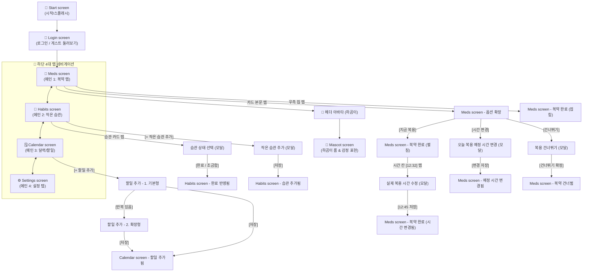

# 🏥 [보건약학프로젝트] 제품 기능 및 개발 명세서 (PRD)

본 문서는 실제 모바일 앱(Flutter 기반) 개발 및 피그마(Figma) 프로토타입 구현을 위한 **제품 기능 요구사항, 화면별 동작 스펙, 데이터 모델, 비즈니스 로직 및 엔지니어링 구현 가이드**를 정의한 기술 명세서임.

**문서 상태:** 본 기획과 연결된 Figma 디자인은 초기 논의를 위한 임시 초안이며 완성본이 아님. 구현 중 모순, 누락, 사용성·접근성 문제 또는 불필요한 복잡성이 발견되면 검토·개선할 수 있음. 작업 분할·저장, Figma 확인, 코드 주석, 스킬 사용 등 작업자 지침은 [`AGENTS.md`](AGENTS.md)를 따름.

*학술적 추진 배경, 약학적 치료역 이론, 문헌 연구 근거 및 조원 분담 가이드는 [`보고서_기획서_보건약학적_배경.md`](file:///c:/Users/nahap/Desktop/2026/2-2/project_hagom/보고서_기획서_보건약학적_배경.md)를 참조할 것.*

---

## 1. 제품 개요 및 디자인 규격

* **제품명**: 보건약학프로젝트 (복약 순응도 및 멘탈 웰니스 케어 앱)
* **핵심 타깃**:
  * **주 대상**: 약 복용과 생활습관(수면, 식사, 가벼운 활동)을 함께 관리해야 하는 **정신건강의학과 환자군 (우울증, ADHD 등)**
  * **확장 대상**: 영양제/건강기능식품 및 만성질환 약을 규칙적으로 복용하려는 일반인
* **디자인 원칙**:
  * 복잡한 수치 나열을 배제한 **미니멀 생산성 인터페이스 (Clutter Pro 스타일)**
  * **듀오링고(Duolingo)** 스타일의 유머러스하고 친근한 밈 마스코트 인터랙션 채택
* **메인 컬러 팔레트**:
  * **Primary Purple (`#7B61A8`)**: 메인 헤더, 프로그레스 바, 기본 버튼, 라벤더 닷
  * **Secondary Brown (`#8D6E63`)**: 처방 필수 항목 및 약제 정보 강조
  * **Success Green (`#34A853`)**: 복약 완료 배지, 달력 100% 완료 틴트 (`#E6F8F0`), 텍스트 (`#065F46`)
  * **Warning Orange (`#F59E0B`)**: 달력 부분 달성 캡슐 바
  * **Alert Red (`#EF4444`)**: 달력 약 미복용 캡슐 바 및 경고 숫자
  * **Background Light Purple (`#F8F6FF`)**: 확장 카드 강조 배경 (Border: `#E0D7F5`)

---

## 2. 핵심 운영 및 UX 정책 (Core Policies)

### ① 💊 복약 알림 상시 작동 정책 (스위치 배제 원칙)
* 약물의 정상 상태 혈중 농도(Steady-State) 유지 및 안전성 확보를 위해, **복약 알림은 해제 불가한 앱의 필수 기본 기능으로 상시 작동함.**
* 일반 할일 및 습관 알림은 사용자 선택에 따라 ON/OFF 가능하게 구현함.
* **스위치 배제 UI 원칙**: 설정 화면에 비활성화된 토글 스위치(Disabled Toggle)를 배치하여 불필요한 시각적 거부감이나 "왜 안 꺼지지?"라는 혼란을 유발하지 않도록, **복약 알림에는 토글 스위치 자체를 아예 만들지 않음.** 대신 "필수 기본 복약 알림 (항상 켜짐)" 형태의 상시 안내 카드로 고지함. (사용자는 상단의 '알림 빈도 조절'을 통해 알림 수신 강도만을 조정함).

### ② 비처벌적 UX 정책 (Non-punitive Policy)
* 약을 먹지 못했거나 습관을 지키지 못한 날에도 **빨간색 실패 도장이나 경고 문구를 일체 노출하지 않음.**
* **연속 기록 실패 강박 및 채찍질 멘트 전면 금지**: 실패 압박이나 연속 기록 리셋으로 사용자를 채찍질하는 방식은 특히 우울증·ADHD 환자에게 극심한 자책감과 앱 이탈(Churn)을 유발함.
  - ❌ **금지 문구**: *"또 약 복용 잊으셨어요! 15일 연속 기록이 리셋됐어요"*
  - ⭕ **권장 축하 문구**: *"이번 달에 벌써 15번이나 약 복용을 지키셨어요!"*, *"절반이라도 실천한 것이 소중한 한 걸음이에요!"*
* 연속 성공(Streak) 강박 대신 **'월간 누적 성공 일수(Self-Monitoring)'** 카운터를 메인 긍정 지표로 활용함.
* **과거 날짜 사후 기록 무조건 축하 시스템 (소급 축하 정책)**: 당일 체크뿐만 아니라 어제나 과거 날짜의 복약/습관을 뒤늦게 완료했다고 수정해도 차별하거나 질책하지 않고, *"언제든 기록해 준 것 자체가 대단해요! 👏"*라며 동일하게 기쁘게 축하해 줌.
* **TDM(치료약물모니터링) 연동 동적 회차 슬롯**: 약 복용 전에는 '예정 시각'(`아침 8:00`)을 표시하고, 복용 완료 시 '실제 복약 시각'(`아침 10:14`)으로 동적 전환하여 실제 임상 혈중농도 관리에 부합하도록 함.
* **원터치 인라인 되돌리기(Undo)**: 완료 상태에서 재터치 시 하단 축하 토스트 안에 `[되돌리기]` 액션 버튼을 함께 제공하여 실수로 완료했을 때도 1초 만에 안전하게 롤백할 수 있도록 보호함.
* 건너뛴 기록에 대해서도 하루 전체가 아닌 '남은 특정 회차'만 핀셋 건너뛰기 처리하고, 취소선과 흐린 텍스트로 자연스럽게 처리하여 자책감을 방지함.
---

## 3. 구글 캘린더 스타일 반복(Recurrence) 시스템 규격

### ① 💊 약 복용 (Medication) 반복
* **매일 (Daily)**: 매일 지정된 시간에 알림 발생.
* **하루 N번 (다회 복용)**: 1일 복용 횟수 선택 시 시간 입력 필드 자동 동적 생성.
* **격일 복용 (Every 2 Days)**: 2일 주기로 알림 계산.
* **월간 복용 (Monthly)**: 매월 특정 일자 또는 N번째 특정 요일 알림.

### ② 🌱 습관 (Habits) 반복
* **매일**: 매일 실천 목록에 노출.
* **주간 자유 빈도형**: *"일주일에 N번 실천"* (주간 누적 횟수 카운팅).
* **주간 지정 요일형**: *"매주 특정 요일 실천"* (예: 월/수/금).
* **월간 목표형**: 월간 누적 횟수 관리.

### ③ 📝 할일 / 일정 (Tasks) 점진적 반복 UI
* 기본 등록 화면에서는 **`[반복 없음]`** / **`[반복 있음]`** 2개 선택지만 노출함.
* **`[반복 있음]`** 탭 시 하단으로 구글 캘린더 형태의 세부 옵션(주기, 요일, 종료일)이 아코디언 방식으로 펼쳐짐.

---

## 4. 마스코트 시스템 규격 (Mascot Specs)

*공식 마스코트 명칭은 **‘하곰이’**(하트 곰돌이)로 확정함. 사용자가 제공한 손그림 일러스트 에셋([`assets/hagomi.png`](file:///c:/Users/nahap/Desktop/2026/2-2/project_hagom/assets/hagomi.png))을 원본 그대로(무수정·무가공) 공식 대표 이미지로 채택하여 전 화면 헤더 아바타, 마스코트 룸, 위젯 및 알림에 적용함.*

### ① 5대 접점 13~24컷 규격
| 접점 | 노출 위치 | 규격 및 컷 수 | 세부 연출 스펙 |
| :---: | :--- | :---: | :--- |
| **1** | **앱 아이콘 & 알림** | 1컷 | 캐릭터 얼굴 클로즈업 ➔ 푸시 알림 좌측 프로필 아이콘 연동 |
| **2** | **시작/스플래시** | 1~3컷 | 웰컴 표정 (기본 안정형) |
| **3** | **전체 성공 축하** | 3~5컷 | 오늘 목표 100% 달성 시 팝업, 폭죽 효과 및 쌍따봉 연출 |
| **4** | **성취(출석) 창** | 3~5컷 | 누적 출석 마일스톤 달성 시 해금되는 표정 |
| **5** | **홈 화면 위젯** | 5~10컷 | 2×1 미디엄 규격 (338×158 dp)<br>• 의욕 증진 4종 (기쁨 / 응원 / 돌아와 / 집착)<br>• 원탭 체크 3종 (복약 / 습관 / 할일) |

*감정 톤은 3대 단계(① 친절-격려: 칭찬·응원 ➔ ② 친절-압박: 걱정·믿음 ➔ ③ 부담-압박: 미접속 시 듀오링고식 집착 밈)로 분기하며, 푸시 알림 텍스트의 톤앤매너로 이원화함.*
* **비처벌적 연출 경계선 (엄격 준수)**: 정신과 및 만성질환 환자의 실패 강박과 자책감을 자극하지 않도록, **칼·흉기나 위협적인 분노 묘사는 전면 배제**함. 장기 미접속(4일 이상) 시에도 공포가 아닌 유쾌한 집착 밈이나 아련한 슬픔/걱정 모드로 순화함.

### ② 전 화면 헤더 상시 아바타 (`Header Companion Avatar`)
* 모든 메인 탭 헤더 우측에 **36×36 dp 원형 아바타 버튼 (`•ᴗ•`)** 을 상시 배치함.
* 탭 시 마스코트 인터랙션 룸(`Mascot screen`)으로 즉시 이동하여 컨디션 표정을 선택하게 하거나 응원 말풍선을 띄움.
* *화면 상단 배너 형태는 실제 복약 카드 리스트의 수직 공간을 잠식하므로 배제함.*

### ③ 홈 화면 위젯 시스템 상세 규격 (2×1 미디엄 규격, 7종 세트)
1×1 위젯의 극심한 공간 협소함을 극복하고, 앱을 실행하지 않고도 스마트폰 바탕화면에서 즉각적인 확인과 조작이 가능하도록 **2×1 규격(338×158 dp) 기반의 2대 그룹 7종 위젯**을 표준 규격으로 정의함:

#### [그룹 A: 동기부여 & 마스코트 상호작용형 (4종)]
1. **위젯 1: 도파민 연속 달성 (Streak & Adherence)**:
   - 상단 뱃지: `🔥 복약 & 습관 연속 달성`
   - 타이틀/서브: *"벌써 5일째 완벽해요!"*, *"약효 유지율 100% 달성 중 ✨"*
   - 우측 마스코트: 기쁨과 성취의 폭죽 표정 (`٩(ˊᗜˋ*)و`)
2. **위젯 2: 마스코트 격려 한마디 (Mascot Cheer)**:
   - 상단 뱃지: `💬 오늘의 응원 한마디`
   - 타이틀/서브: *"오늘도 한 걸음씩!"*, *"점심 약 잘 챙겨 먹었지? 남은 하루도 파이팅이야 🌱"*
   - 우측 마스코트: 다정한 응원 표정 (`( •ᴗ• )੭`)
3. **위젯 3: 다음 약 카운트다운 (Next Med Countdown)**:
   - 상단 뱃지: `⏰ 다음 복약까지`
   - 타이틀/서브: *"2시간 15분 남음"*, *"오후 7:00 • 소염진통제 1정"*
   - 우측 아이콘: 💊 식후 30분 안내 카드
4. **위젯 4: 주간 복약 요약 (Weekly Summary)**:
   - 상단 뱃지: `📊 이번 주 복약 성적`
   - 타이틀/서브: *"주간 달성률 92%"*, *"총 14회 중 13회 완료! 아주 우수해요"*
   - 우측 미니 차트: `13/14회 완료` 원형 인디케이터

#### [그룹 B: 앱 진입 없는 1-Tap 퀵 액션형 (3종)]
5. **위젯 5: 오늘의 약 원탭 복약 (One-tap Med Check)**:
   - 상단 뱃지: `💊 지금 복용할 약`
   - 타이틀/서브: *"혈압약 & 비타민D"*, *"오후 1:00 • 점심 식후 1정"*
   - **우측 액션 버튼**: **`[복용 완료 ✓]`** 버튼 ➔ 앱을 열지 않고 바탕화면에서 터치 즉시 복약 타임스탬프 기록 및 완료 처리.
6. **위젯 6: 습관 퀵 체크 (Quick Habit Check)**:
   - 상단 뱃지: `🌱 데일리 습관`
   - 타이틀/서브: *"물 500ml 마시기"*, *"오늘 3/4잔 완료 (75%)"*
   - **우측 액션 버튼**: **`[한 잔 체크 ✓]`** 버튼 ➔ 바탕화면에서 1-Tap 즉시 카운팅.
7. **위젯 7: 다음 일정 및 할일 퀵 체크 (Next Schedule & Task)**:
   - 상단 뱃지: `📅 예정된 할일`
   - 타이틀/서브: *"내과 정기 검진"*, *"10월 16일 (금) 오전 10:30"*
   - **우측 액션 버튼**: **`[확인 완료 ✓]`** 버튼 ➔ 일정 확인 완료 처리.

---

## 5. 핵심 탭별 상세 기능 요구 명세 (Feature Specifications)

### 5.1. 💊 복약 탭 (Medication Tab)

#### [화면 4대 상태 및 카드 동작 규격]
1. **상태 1: 초기 접힘 상태 (Meds screen)**
   - **우측 칩(`Status pill`) 터치**: **1-Tap 즉시 복용 완료 처리** ➔ 상태 3A(완료 접힘)로 즉시 전환.
   - **카드 본문(`Medication copy`) 터치**: 아코디언 확장 ➔ 상태 2(옵션 확장)로 전환 (`Smart Animate` 0.3s).
   - 상단 헤더: `오늘 · 1/3` 및 `🩺 의사 처방 준수율: 7일 중 5일 완료` 표시.
2. **상태 2: 옵션 확장 상태 (Meds screen - 옵션 확장)**
   - 카드 배경을 연보라(`fills: #F8F6FF`, `stroke: #E0D7F5`)로 강조.
   - 3대 액션 버튼 노출:
     - **[지금 복용]** (보라색 Primary): 탭 시 상태 3B(완료 펼침)로 이동.
     - **[시간 변경]** (흰색 테두리 Secondary): 탭 시 `오늘 복용 예정 시간 변경` 모달 오버레이 오픈.
     - **[건너뛰기]** (연회색 Skip): 탭 시 `복용 건너뛰기` 모달 오버레이 오픈.
   - 카드 본문 터치 시: 다시 상태 1(초기 접힘)로 축소 복귀.
3. **상태 3: 복약 완료 상태군**
   - **상태 3B: 완료 펼침 (Meds screen - 복약 완료)**
     - 상단 진행률 `오늘 · 2/3` 및 준수율 `7일 중 6일 완료 👏`로 즉시 갱신.
     - 카드 내 `[✓ 복용 완료]` 녹색 배지 + `[오후 12:32]`(실제 타임스탬프) + `[되돌리기]` 버튼 노출.
     - **🌟 [오후 12:32] 시간 칸 터치 시**: `실제 복용 시간 수정` 바텀시트 모달 오픈.
     - `[되돌리기]` 터치 시: 직전 미복용 상태로 즉시 롤백 (실수 복구 보장).
     - 우측 칩 터치 시: 상태 3C(시간 표시 칩 '12:32 복용')로 축소.
     - 카드 본문 터치 시: 상태 3A(완료 접힘)로 스르륵 접힘.
   - **상태 3A: 완료 접힘 (Meds screen - 복약 완료 접힘)**
     - 흰색 배경에 `[✓ 복용 완료]` 녹색 칩만 단정하게 표시함.
   - **상태 3C: 시간 표시 (Meds screen - 복약 시간 표시)**
     - 우측 칩에 `12:32 복용` 텍스트 표시 ➔ 칩 터치 시 바로 `실제 복용 시간 수정` 모달 오픈.
   - **상태 3D: 시간 수정 완료 (Meds screen - 복약 완료 시간 변경됨)**
     - 모달에서 [오후 12:45] 선택 저장 시 카드 텍스트가 `오후 12:45 복용 (12:30 처방)`으로 실시간 갱신됨.
4. **상태 2B: 예정 시간 변경 완료 (Meds screen - 예정 시간 변경됨)**
   - 모달에서 [오후 1:00] 선택 시 `18mg · 서방정 · 오후 1:00 (알림 변경됨)`으로 변경 표시.
5. **상태 2C: 복약 건너뜀 (Meds screen - 복약 건너뜀)**
   - 카드 불투명도 85%, 회색 톤(`건너뜀` 칩), 상단 텍스트 `🩺 이번 복용을 건너뛰었어요 · 다음 복용에 집중해요 🌿`로 처리.
   - 건너뛴 카드를 다시 누르면 언제든 미복용 상태로 복구 가능함.

#### [모달 동작 원칙 (피그마 & 실제 앱 공통 규격)]
* **모달 닫기**: 모달 바깥 배경 터치 또는 모달 내 **[취소]** 버튼 클릭 시에만 닫힘 (`CLOSE`).
* **모달 내 기능 버튼**: 단순 닫힘이 아니라 **실제 데이터 저장 및 화면 상태 전환**을 수행함 (`NAVIGATE`).
* **1버튼 1리액션 원칙**: 버튼 컨테이너에만 단독 1개 리액션을 걸고, 내부 텍스트에는 리액션을 중복 부여하지 않음.
* **오늘은 복용/실천일이 아닌 약·습관의 하단 1줄 슬림화 정책**:
  - 주 1회 복용약(예: 매주 일요일 비타민 D 고용량)이나 이번 주 실천 목표를 이미 달성한 주간 습관은 상단 메인 목록을 차지하지 않도록 분리함.
  - 상단에는 오늘 복용·실천해야 할 항목만 집중 배치하고, 오늘은 아닌 항목은 하단에 설명 제목 없이 **단정한 1줄 슬림 바 형태**로 차분하게 내려앉혀 환자의 시각적 스트레스와 인지 부하를 줄임.
---

### 5.2. 🌱 작은 습관 탭 (Habits Tab)

#### [화면 3대 상태 및 카드 동작 규격]
1. **상태 1: 초기 습관 목록 (Habits screen)**
   - **상단 프로그레스 바**: `4개 중 2½개 완료 · 63%` (보라색 게이지 바).
   - **카드 인터랙션 이원화 (복약 탭과 일관성 엄수)**:
     - **우측 원형 상태 칩 탭**: **1-Tap 퀵 토글 순환**. 모달을 열지 않고도 1초 만에 상태를 즉시 순환 변경함:
       **대기(○) → 완료(●) → 조금 완료(◐) → 대기(○)**
     - **카드 본문(`Habit copy`) 탭**: `습관 상태 선택` 바텀시트 모달 오버레이 오픈.
   - **하단 플로팅 CTA**: `+ 작은 습관 추가` 버튼 ➔ 추가 모달 호출.

2. **상태 2: 실천 완료 반영 화면 (Habits screen - 완료 반영됨)**
   - 대상 항목('조금 움직이기')이 `[●]` 녹색 원형 배지로 변경됨.
   - 상단 진행률이 **`4개 중 3½개 완료 · 88%`**로 실시간 게이지 확장 (`Smart Animate` 0.3s).
   - 완료된 카드를 다시 탭하면 언제든 모달을 열어 `[조금 완료]`로 수정 가능 (되돌리기 보장).

3. **상태 3: 신규 습관 추가 화면 (Habits screen - 습관 추가됨)**
   - 모달에서 저장 완료 시 목록 최상단에 `[NEW]` 배지와 함께 새 카드(`책상 위 물 한 컵 ✨ · 언제든 1분이라도`) 즉시 삽입.
   - 전체 모수가 4개에서 5개로 늘어나며 진행률이 `5개 중 2½개 완료 (+새 습관 ✨)`로 재계산됨.

#### [시각적 메타포 및 스타일링 규격 (Circle Fill Progression)]
* **`○` 대기 (0% 시작 전)**: 테두리 옅은 회색(`Border: #CBD5E0`), 배경 투명/흰색. 아직 채우지 않은 빈 상태.
* **`◐` 조금 완료 (0.5점, 50% 절반 채움)**: 왼쪽 절반 채움(`Fill: #7B61A8` 또는 `#F59E0B`). 미완료 느낌의 `—` 대신 "절반이라도 채웠다"는 긍정적 진행도를 직관적으로 전달함.
* **`●` 완료 (1.0점 만점, 100% 꽉 채움)**: 싱그러운 녹색 가득 채움(`Fill: #34A853`). 목표를 완벽하게 달성함.
* *'오늘 쉬기' 항목은 불필요한 선택지 복잡도를 줄이기 위해 배제하며, 미실천 항목은 기본 0점(대기)으로 유지함.*

#### [모달 2종 세부 동작 및 입력 스펙]
1. **`습관 상태 선택` 모달 ("오늘은 어떻게 했나요?")**
   - 상단 요약 정보: 선택된 습관명, 목표 빈도, 누적 출석일수.
   - **2대 상태 선택 칩**:
     - **`[● 완료]`** (1.0점, 녹색): *"완벽해요! 습관을 끝마쳤어요."*
     - **`[◐ 조금 완료]`** (0.5점, 연보라/주황): *"절반이라도 채운 게 어디예요! 훌륭해요."*
   - 모달 닫기 규칙: 바깥 배경 터치 또는 [취소] 클릭 시에만 닫힘. [상태 기록] 버튼 클릭 시 상태 2로 화면 전환.
2. **`작은 습관 추가` 모달**
   - **입력 필드 스펙**:
     - 습관명 입력창 (예: 책상 위 물 한 컵)
     - 실천 가이드 텍스트 (예: 언제든 · 1분이라도)
     - 목표 빈도 라디오: `[매일]` / `[주간 자유 빈도 (주 N회)]` / `[특정 요일 선택]`
     - 리마인드 알림 시간대 설정
   - [저장] 버튼 클릭 시 목록 최상단에 새 습관 생성.

#### [비즈니스 로직 & 달성률 계산 공식]
* **일일 습관 달성률 계산 공식**: 전체 등록 습관 수가 0이면 진행률을 0%로 표시함. 그 외에는 `((완료 습관 수 × 1.0 + 조금 완료 습관 수 × 0.5) ÷ 전체 등록 습관 수) × 100`으로 계산함.
* **주간 자유 빈도형 습관 계산**: "주 3회 실천" 습관의 경우, 월~일 중 실천한 날짜 횟수가 3회에 도달하면 해당 주차 목표 완료로 판정.
* **자정 00:00 일일 롤오버**: 전날의 실천 스코어(`1.0 / 0.5 / 0.0 미실천`)는 히스토리 DB로 영구 보존되고, 오늘 날짜 인스턴스는 기본 `대기 (○)` 상태로 자동 초기화됨.

---

### 5.3. 📅 달력 & 할일 탭 (Calendar & Tasks Tab)

#### [화면 2대 상태 및 날짜 셀 동작 규격]
1. **상태 1: 기본 달력 화면 (Calendar screen)**
   - **월간 뷰 헤더**: `2026년 10월`, 이전/다음 달 이동 버튼(`◀`/`▶`), [오늘로 이동] 텍스트 버튼.
   - **달력 날짜 셀 시각화 3단계 알고리즘 (복약 및 습관 통합 규격)**:
     - **[1] 전부 다 한 날 (복약 100% + 습관 100%)**: 날짜 셀 전체를 **'통으로' 연초록 파스텔 틴트(`#E6F8F0`)**로 채우고 하단 바는 숨김. 단, 일요일 숫자는 요일 구분을 위해 빨간색 글자색을 보존함.
     - **[2] 처방약 누락일**: 의사의 처방 필수약을 놓친 날은 임상적 경고를 위해 **흰색 셀 + 하단 빨간색 캡슐 바(`#EF4444`)** 표시.
     - **[3] 뭔가 덜 한 날**: 처방약은 먹었으나 일반약이나 습관 중 하나라도 미완료된 날은 **흰색 셀 + 하단 웜브라운 캡슐 바(`#8B5E3C`)** 표시.
     - **[4] 미래 날짜**: 아직 도래하지 않은 날짜는 바나 틴트 없이 **완전한 순백색(White)**으로 초기화.
   - **하단 데일리 상세 아코디언 (`Daily Schedule Accordion`)**:
     - 오늘 날짜는 [복약 탭]과 [습관 탭]에서 전담 체크하도록 **수정 버튼 없이 단순 1줄 요약(조회용)**만 차분하게 노출.
     - 지난 과거 날짜 선택 시에만 **`수정하기`** 버튼이 나타나 소급 체크를 지원함.
     - 일정 기능: 오늘/미래는 `할일 추가`, 과거 날짜는 `한일 추가`로 명칭을 자동 전환하고, 탭 시 아코디언 메뉴에서 `정보 수정`, `되돌리기`, `삭제`를 안전하게 지원함.
     - 특정 날짜 터치 시 하단에 그날의 종합 데이터 패널이 펼쳐짐 (`10월 14일 수요일 · 3개 일정`):
       1. **그날의 복약 요약 카드**: Focusin 10mg 오전 8:00 복용 완료(12:32 타임스탬프), 12:30 대기 등.
       2. **그날의 습관 실천 현황**: 물 한 컵 마시기(● 완료), 조금 움직이기(◐ 절반) 등.
       3. **등록된 할일 리스트**: 체크박스 완료 토글 및 과제 마감시간 표시.
   - **하단 플로팅 CTA**: `+ 할일 추가` 버튼.

2. **상태 2: 할일 추가 반영 화면 (Calendar screen - 할일 추가됨)**
   - 모달에서 저장 시 선택일 헤더 뱃지가 **`오늘 일정 3건` ➔ `오늘 일정 4건 (+새 일정 ✨)`**으로 갱신.
   - 일정 리스트 맨 위에 **`[NEW] 🗓️ 약학 실습 보고서 작성 (오후 6:00 · 30분 전 알림)`** 카드 즉시 삽입.
   - 해당 날짜 셀의 **오른쪽 위 모서리(Top-Right Corner: `top: 4px, right: 4px`)**에 라벤더 닷(`• #7B61A8`) 핀이 실시간 생성됨.

#### [할일 추가 모달 2단계 점진적 UI 스펙]
1. **`할일 추가 - 1. 기본형` (가벼운 기본 폼)**
   - 평소에는 불필요한 옵션을 숨겨 입력 피로도를 낮춤.
   - **입력 필드**: 할일 제목, 날짜 선택기(DatePicker), 시간 선택기(TimePicker), 알림 설정 (정시 / 30분 전 / 1시간 전).
   - **반복 토글 선택지**:
     - **`[● 반복 없음]`**: 단발성 과제/진료 일정 (기본 선택).
     - **`[○ 반복 있음]`**: 탭 시 하단으로 구글 캘린더 스타일 세부 카드가 스르륵 펼쳐짐 (`Smart Animate`).
   - 하단 [할일 저장] 클릭 시 상태 2로 화면 전환.
2. **`할일 추가 - 2. 확장형` (구글 캘린더 스타일 아코디언)**
   - `[● 반복 있음]` 선택 시 펼쳐지는 세부 설정:
     - 반복 주기 드롭다운: 매일 / 매주 / 격주 / 매월.
     - 요일 다중 선택 칩: `[월] [화] [수] [목] [금] [토] [일]`.
     - 종료 조건 라디오: `[계속 반복]` / `[특정 날짜까지]` / `[N회 반복 후 종료]`.
   - 하단 [반복 일정 저장] 클릭 시 상태 2로 전환.

#### [보건약학 임상 특화: 과거 날짜 TDM 브리핑 연동]
* 환자가 병원 진료 시 의사에게 복약 순응도를 설명할 수 있도록, **과거 날짜(예: 10월 3일 약 미복용일)를 터치하면 하단 아코디언에서 "그날 약을 왜 건너뛰었는지(사유: 속쓰림 및 메스꺼움)"**를 즉시 열람할 수 있도록 설계함 (진료 상담용 디지털 TDM 차트 역할).

---

### 5.4. ⚙️ 설정 탭 (Settings Tab)

#### [5대 알림 통합 설정 시스템 (Notification Matrix)]
복약 알림의 의학적 강제성을 유지하면서도 불필요한 스위치 조작 혼란을 없애고, 환자의 알림 피로도를 합리적으로 제어할 수 있도록 **[빈도 조절 1종 + 상시 필수 복약 안내 카드 1종 + 기능별 자유 토글 3종 = 총 5대 알림 체계]**를 구축함:

1. **알림 빈도 수 조절 (Frequency Controller, 1종)**:
   - 사용자가 하루에 받을 알림의 재촉 강도를 선택하는 통합 제어 슬라이더/라디오 버튼임.
   - **선택지 3단계 (사전 예고 및 복용 완료 보장 체계)**:
     - **`[최소]` (정시 1회 알림)**: 약속된 시간에 딱 1번만 차분하게 알리고 재알림 없음.
     - **`[기본]` (15분 전 사전 예고 + 정시 + 30분 후 1회 리마인드)**: 15분 전 식사/물 준비 예고 알림 ➔ 정시 복약 ➔ 미복용 시 30분 뒤 1회 추가 리마인드 (기본 권장값).
     - **`[적극적]` (30분 전 사전 예고 + 정시 + 복용 완료할 때까지 15분 간격 지속 알림)**: 30분 전 사전 예고 ➔ 정시 복약 ➔ **환자가 앱에서 '지금 복용'을 완료할 때까지 15분 간격으로 끊김 없이 챙겨주는 집중 밀착 케어**.
   - **💡 복약 알림 제어의 유일한 창구**: 일반 복약 알림 스위치는 끌 수 있으나, 의사 처방 필수 약물은 안전을 위해 항시 켜짐을 유지하며, 알림 스트레스를 최소화하고 싶은 사용자는 이 빈도 설정을 **`[최소]`**로 낮추어 완화함.
3. **기능별 자유 토글 알림 (자유 ON / OFF, 3종)**:
   - **① 🌱 작은 습관 알림**: 데일리 루틴 실천 시간대 리마인드 알림 수신 여부 선택.
   - **② 🗓️ 달력/할일 알림**: 등록된 일정 및 과제 마감 30분 전 알림 수신 여부 선택.
   - **③ 🐻 마스코트(하곰이) 응원 및 넛지 알림**: 앱 미접속 일수(1~3일 애절 모드, 4일 이상 듀오링고식 집착 모드)에 따른 밈 알림 및 데일리 응원 문구 수신 여부 선택.

#### [데이터 및 계정 관리]
* **로컬 데이터 내보내기**: 복약 이력 CSV 다운로드, 의사 진료 상담용 요약 텍스트 메모 복사.
* **계정 탈퇴 및 로컬 DB 영구 삭제**: 스토어 심사 필수 요건 준수를 위한 로컬 데이터 완전 초기화 기능 탑재.

---

## 6. 기술 아키텍처 및 구현 스펙 (Engineering Specification)

### 6.1. 화면 흐름도 (App Screen Navigation Flow)



---

### 6.2. 로컬 데이터베이스 모델 스키마 (Hive / SQLite Entity Spec)

오프라인 우선(Offline-First) 구동을 위한 핵심 엔티티 정의임:

#### 1) `Medication` (약 등록 정보)
```dart
class Medication {
  final String id;              // UUID
  final String name;            // 약 이름 (예: 콘서타 OROS)
  final String dosage;          // 용량 (예: 18mg)
  final String instructions;    // 복용법 (예: 서방정, 식후 물과 함께)
  final List<String> times;     // 알림 시간 목록 (예: ["12:30"])
  final String recurrence;      // DAILY, MULTI, EVERY_TWO_DAYS, MONTHLY
  final bool isPrescription;    // 의사 처방 필수약 여부 (강조 색상 적용)
  final DateTime createdAt;
}
```

#### 2) `DoseLog` (실제 복약 이력)
```dart
class DoseLog {
  final String id;              // UUID
  final String medicationId;    // 외래키
  final DateTime date;          // 기준 일자 (2026-10-29)
  final String scheduledTime;   // 예정 시간 (예: "12:30")
  final String? actualTime;     // 실제 복용 타임스탬프 (예: "12:45")
  final String status;          // PENDING(대기), TAKEN(완료), SKIPPED(건너뜀)
  final String? skipReason;     // 건너뜀 사유 (잊음, 부작용, 속쓰림 등)
}
```

#### 3) `Habit` & `HabitLog` (습관 및 실천 이력)
```dart
class Habit {
  final String id;
  final String title;           // 습관명 (예: 조금 움직이기)
  final String subtitle;        // 설명 (예: 1분 스트레칭)
  final String frequency;       // DAILY, WEEKLY_FREE, WEEKLY_DAYS
  final List<int>? targetDays;  // 요일 지정 (1=월 ~ 7=일)
}

class HabitLog {
  final String id;
  final String habitId;
  final DateTime date;
  final double score;           // 1.0(완료), 0.5(조금 함), 0.0(미실천)
  final String status;          // FULL, HALF, REST
}
```

#### 4) `Task` (할일 및 일정)
```dart
class Task {
  final String id;
  final String title;           // 일정명
  final DateTime date;          // 날짜
  final String? time;           // 시간
  final bool isCompleted;       // 완료 여부
  final bool hasRecurrence;     // 반복 여부
  final String? recurrenceRule; // WEEKLY_WED 등
}
```

#### 5) `MascotState` (마스코트 성장 및 출석 상태)
```dart
class MascotState {
  final int totalAttendanceDays;// 총 접속 일수 (Self-Monitoring)
  final int returnedCount;      // "다시 돌아옴" 누적 횟수
  final int gentleAttempts;     // "부드럽게 시도" 누적 횟수
  final int helpRequests;       // "도움을 요청" 누적 횟수
  final String currentMood;     // HAPPY, CALM, TIRED, MISSED
}
```

---

### 6.3. 핵심 비즈니스 로직 & 구현 가이드

#### 1) 로컬 푸시 알림 엔진 (`flutter_local_notifications`)
* `flutter_local_notifications` + `timezone` 패키지 활용.
* 복약 알림 채널은 `Importance.max`, `Priority.high`로 지정함.
* 기기 재부팅 시 OS에 의해 알림이 초기화되므로 `RECEIVE_BOOT_COMPLETED` BroadcastReceiver를 구현하여 DB로부터 복약 알림을 자동 재등록함.

#### 2) 자정 00:00 일일 롤오버 처리 (Daily Midnight Reset)
* 앱 시작 및 포그라운드 복귀 시 현재 일자(`DateTime.now()`)를 체크함.
* 날짜 변경 감지 시:
  1. 어제 날짜 미기록 약물은 `PENDING`에서 당일 마감 확정 처리함.
  2. 오늘 날짜의 `DoseLog` 및 `HabitLog` 인스턴스를 기본 상태로 생성함.
  3. 일일 진행률을 `0/N`으로 초기화함.

#### 3) 달력 6안 색칠 판별 로직 (Dart 구현 규격)
```dart
Color getCellBackgroundColor(DateTime date, List<DoseLog> dayLogs) {
  if (date.isAfter(DateTime.now())) {
    return Colors.transparent; // 미래 날짜는 완전 초기화
  }
  if (dayLogs.isEmpty) return Colors.transparent;
  
  final allTaken = dayLogs.every((log) => log.status == 'TAKEN');
  if (allTaken) {
    return const Color(0xFFE6F8F0); // 100% 완료: 연초록 통 채움
  }
  return Colors.transparent; // 부분 달성/미복용은 하단 바로 표시
}

Widget? getCellBottomBar(DateTime date, List<DoseLog> dayLogs) {
  if (date.isAfter(DateTime.now()) || dayLogs.isEmpty) return null;
  
  final takenCount = dayLogs.where((log) => log.status == 'TAKEN').length;
  if (takenCount == dayLogs.length) return null; // 100% 완료는 바 숨김
  
  if (takenCount > 0) {
    return CapsuleBar(color: Color(0xFFF59E0B)); // 부분 달성: 주황색 바
  } else {
    return CapsuleBar(color: Color(0xFFEF4444)); // 미복용(0%): 빨간색 바
  }
}
```

---

## 7. 단계별 개발 로드맵 (MVP vs 확장 기능)

### ⚪ [0단계: 앱 기본 골격과 공통 탐색]
제품별 업무 기능에 앞서 앱의 공통 화면 구조와 이동을 검토하는 단계임. 이 단계에서는 복약·습관·달력 탭의 도메인 기능을 구현하지 않음.
* **시작 화면**: 앱 실행 시 표시할 시작 화면과 공통 탭 구조를 구현함.
* **빈 탭 화면**: 복약 탭, 습관 탭, 달력 탭은 제목과 간단한 빈 상태만 표시함. 약·습관·할 일 추가, 상태 변경, 기록·통계·알림 등 탭별 기능은 포함하지 않음.
* **공통 이동**: 시작 화면과 탭 사이 이동, 설정 화면 진입, 마스코트 화면 진입 및 기본 표시를 구현함.
* **이미지 재사용**: 현재 보유한 하곰이 이미지 1개를 여러 위치에 임시 재사용할 수 있음. 각 화면 용도별 자산 변수는 의미에 맞게 나누어 실제 전용 이미지로 쉽게 교체하도록 함. 자세한 지침은 `AGENTS.md`를 따름.
* **완료 조건**: Android 에뮬레이터에서 실행되고 공통 화면 이동이 동작하며 세 탭이 빈 상태로 표시됨. 테스트·정적 분석·화면 확인 결과를 사용자에게 제시하고, 사용자가 0단계 완료를 확인하기 전에는 1단계에 착수하지 않음.

### 🟢 [1단계: 필수 핵심 기능 (MVP)] — 0단계 검토 완료 후 착수
* **마스코트 기본**: 대표 이미지 1컷 + 동적 응원 문구(시작 전/완료 후/터치 시) + 작은 성과 카운터 연동.
* **복약 핵심**: `+ 약 추가`, 카드 수정/삭제, 우측 칩 1-Tap 즉시 완료, 카드 본문 탭 옵션 확장, `[지금 복용]`, `[시간 변경]`, 완료 후 `[실제 복용 시간 수정(12:45)]`, `[건너뛰기]`, `[되돌리기]`, 로컬 푸시 알림(강제 ON).
* **작은 습관 핵심**: `+ 작은 습관 추가`, 2단 달성 평가(`완료 1.0` / `조금 함 0.5`), 상단 게이지 바 및 퍼센트 계산.
* **달력 & 할일 핵심**: 6안 색칠 규칙(연초록 통/주황 바/빨강 바/미래 날짜 초기화), **오른쪽 위 모서리 라벤더 닷(`• #7B61A8`, `top: 4px, right: 4px`)**, 날짜별 상세 아코디언, `+ 할일 추가`(기본형/확장형).
* **로컬 DB 영구 저장**: 앱 재부팅 시에도 모든 데이터가 보존되는 로컬 DB(`Hive` / `SQLite`).

### 🟡 [2단계: 마스코트 고도화 & 홈 위젯 7종 & 5대 알림 센터] — 🌟 사용자 피드백 반영 승격
* **스마트폰 홈 위젯 7종 탑재 (`home_widget` 기반 2×1 규격)**:
  - 동기부여형 4종 (도파민 연속 달성, 마스코트 응원, 복약 카운트다운, 주간 성적 요약)
  - 1-Tap 퀵 액션형 3종 (앱 진입 없이 바탕화면에서 복약 완료, 습관 체크, 일정 확인)
* **마스코트 심화**: 다중 표정 선택 모달(13~24컷 에셋 연동), 누적 출석 기반 표정 해금, 천사/악마 모드 푸시 알림 문구 20종.
* **설정 5대 알림 통합 제어 센터**: 빈도 조절(최소/기본/적극적) 1종 + 탭별 알림 3종 + 마스코트 알림 1종.

### 🔵 [3단계: Firebase 클라우드 동기화 & 데이터 관리]
* **Firebase 동기화**: Google 1-Tap 간편 로그인, 기기 변경 시 Cloud Firestore 실시간 복약·습관 데이터 자동 복원.
* **설정 데이터 관리**: 복약 기록 CSV 다운로드, 계정 탈퇴 및 로컬 DB 영구 삭제, 의학적 면책 고지 안내.

### 🟣 [4단계: 킬러 부가 기능 (Plus-Alpha OCR)] — 선택적 추가
* **온디바이스 한글 OCR (`Google ML Kit Text Recognition v2`)**: 스마트폰 카메라로 처방전/약봉투 촬영 시 약 이름, 용량, 복용 시간 자동 인식 및 1-Tap 일괄 등록 (100% 무료·무제한 온디바이스 처리).

---

## 8. 🌟 사용자 직접 요구사항 및 해결 명세 매핑 (User Requirements Traceability)

본 프로젝트 진행 과정에서 사용자가 직접 제시한 핵심 요구사항과 이를 PRD 및 피그마에 구현·해결한 상세 내역을 총망라하여 정리함:

| 순번 | 사용자 직접 요구사항 | 구현 해결 내용 및 반영 조항 |
| :---: | :--- | :--- |
| **1** | **위젯 2단계 개발 승격** | 위젯을 3단계 부가기능에서 **2단계 핵심 고도화 단계로 전격 승격**. (7장 로드맵) |
| **2** | **위젯 상세 구성 (요청 내역)** | **2×1 미디엄 규격(338×158 dp)**을 표준으로 지정하고, 동기부여형 4종(달성/응원/카운트다운/주간요약) 및 앱 안 켜고 끝내는 **1-Tap 퀵 액션형 3종(복약/습관/할일 즉시 완료)** 총 7종 세트 완전 명세화. (4.3절) |
| **3** | **복약 완료 후 복용 시간 변경 (오후 12:45 수정 플로우)** | 완료 카드의 시간 칸(`오후 12:32`) 터치 시 `실제 복용 시간 수정` 모달을 띄워 실제 투약 시각(`오후 12:45`)으로 갱신하는 약학적 TDM 플로우 완벽 구현. (5.1절) |
| **4** | **오른쪽 작은 완료 버튼 원탭 완료 vs 카드 본문 확장 분리** | 우측 작은 칩(`Status pill`) 터치 시 즉시 완료 접힘으로 직행하고, 카드 본문(`Medication copy`) 터치 시에만 옵션 확장 화면으로 전환되도록 상호작용 이원화. (5.1절) |
| **5** | **[시간 변경] 및 [건너뛰기] 버튼 정상화** | 옵션 확장 상태에서 두 버튼을 각각의 모달 오버레이로 연결하고, 예정 시간 1:00 변경 및 건너뜀 사유 기록 화면으로 완벽 전환. (5.1절) |
| **6** | **모달 닫기 vs 버튼 기능 분리** | 모달 바깥 터치나 [취소] 클릭 시에만 닫히고(`CLOSE`), 모달 내부의 [저장], [시간 변경], [상태 기록] 버튼은 실제 상태를 갱신하도록 분리. (5.1절) |
| **7** | **1버튼 1리액션 원칙 (자식 텍스트 중복 선 제거)** | 버튼 컨테이너에만 단독 1개 리액션을 부여하고, 내부 텍스트(`TEXT`)에 걸려 있던 중복 파란 선을 스크립트로 완전 박멸. (5.1절) |
| **8** | **스크립트 재실행 멱등성 (화면 날아감 방지)** | 피그마 Section 삭제 시 자식 프레임이 함께 지워지던 버그를 잡고, 섹션 내 프레임을 최상위 페이지로 100% 안전 구출하는 로직 구축. (Figma 스크립트) |
| **9** | **습관 기호 직관성 개선 (`○`, `●`, `◐`)** | 혼란을 주던 기호들을 정리하고, 오늘 쉬기를 배제하여 원형 채움 진행도 메타포인 **`○`(대기 0%) / `◐`(조금 완료 0.5) / `●`(완료 1.0)** 3단계 체계로 직관화. (5.2절) |
| **10** | **설정 탭 5대 알림 통합 제어 센터 (복약 스위치 배제)** | **[빈도 조절 1종 (최소/기본/적극적) + 필수 복약 안내 카드(스위치 배제) 1종 + 자유 토글 3종(습관/할일/마스코트) = 총 5대 알림 체계]** 및 비처벌적 누적 축하 멘트 공식 반영. (2절, 5.4절) |
| **11** | **달력 6안 규칙 및 미래 날짜 리셋 & 할일 모서리 닷** | 100% 완료 연초록 통 채움(`#E6F8F0`), 부분 달성 주황 바, 미복용 빨강 바, 미래 날짜 진행도 일체 미표시(초기화) 및 **할일 등록일 날짜 셀 오른쪽 위 모서리 라벤더 닷(`• #7B61A8`, `top: 4px, right: 4px`) 단독 배치** 원칙 엄수. (5.3절) |
| **12** | **헤더 상시 아바타 (`•ᴗ•` 36×36 dp)** | 세로 공간을 잠식하는 1줄 배너를 배제하고, 우측 상단 미니 아바타 단독 채택. (4.2절) |
| **13** | **이론적 배경과 실제 앱 PRD 문서 분리** | 보고서/학술 이론은 `보고서_기획서_보건약학적_배경.md`로 분리하고, 본 문서는 `~한다/~함` 문체의 순수 기술 명세서로 정돈. (전체) |
| **14** | **로드맵 4단계 체계 재편 (Firebase·데이터 3단계, OCR 4단계)** | 2단계(위젯 7종, 마스코트 심화, 5대 알림 센터) ➔ 3단계(Firebase 동기화, CSV 내보내기/계정 데이터 관리) ➔ 4단계(온디바이스 한글 OCR)로 점진적 분리 재편. (7장) |

---

## 9. 기술 스택 및 비용 원칙 (서버비 0원)

* **앱 프레임워크**: **Flutter** (단일 코드로 Android/iOS 대응).
* **비용 원칙 (개발·운영비 0원)**:
  - 로컬 DB(`Hive`), 로컬 알림, 온디바이스 한글 OCR(`Google ML Kit`), 클라우드 인증·DB(`Firebase Spark 무료 티어`) 모두 영구 무료 기술만 사용함.
  - 유일한 선택 비용은 실제 스토어 등록 시 Google Play Console 개발자 등록비 $25 (평생 1회)뿐이며, 내부 테스트 트랙을 통해 당일 즉시 실기기 배포 시연이 가능함.

---

## 10. 접근성 요구사항
* 주요 버튼과 조작 요소의 터치 영역은 최소 **48×48 dp**로 하며, 상태를 색상만으로 전달하지 않고 아이콘·라벨 등 비색상 단서를 함께 제공함.
* 아이콘과 이미지에는 화면 읽기 도구가 이해할 수 있는 의미 라벨을 제공하거나 장식 요소임을 명시함. TalkBack·VoiceOver에서 버튼 역할과 상태가 식별되어야 함.
* 사용자가 시스템 글자 크기를 키워도 핵심 문구나 조작 요소가 잘리거나 숨겨지지 않게 함. 애니메이션 감소 설정을 존중함.
* 일반 텍스트 대비는 WCAG AA 기준 **4.5:1 이상**, 큰 텍스트는 **3:1 이상**을 목표로 하고, 색상이 합성된 실제 배경 기준으로 검증함.
* 접근성 검수 시 주요 화면을 글자 확대, 회색조, 애니메이션 감소 설정에서 확인하고, Android TalkBack 및 iOS VoiceOver로 핵심 흐름을 점검함.